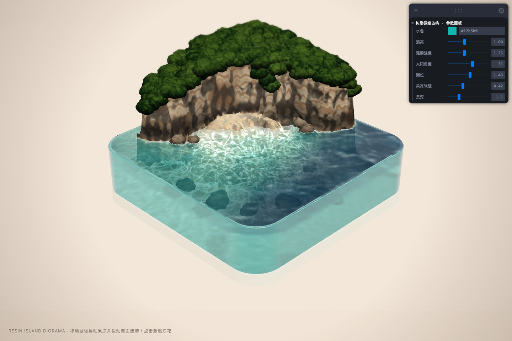

# 🏝️ 树脂块微缩岛屿 · Resin Island Diorama

> **Note:** This is an interactive 3D web demo generated by **Gemini 4 Argon**.  
> **Credits:** The source idea and original prompt come from [@Saccc_c on X](https://x.com/Saccc_c/status/2108870227056623959).



## ✨ Overview

A full-screen interactive 3D miniature diorama featuring a rounded crystal-clear resin block encasing a Kelingking-inspired limestone cliff, a sunlit crescent sandy beach, lush tropical canopy foliage, and shallow-to-deep turquoise seawater. Every 3D mesh, rock, tree canopy, heightfield, and shader in this scene is **100% procedurally generated in code** with zero external 3D model files.

### Key Features

- **Optical Resin Block (`MeshTransmissionMaterial`)**: Rounded-square crystal resin water volume with refractive wall transmission, polished top meniscus bevel, and shallow-to-deep aqua/cerulean depth attenuation.
- **Interactive GPU Heightfield Water (`useWaterSimulation`)**: Ping-pong FBO wave equation solver that creates continuous wakes as your cursor glides across the water, splash waves on click, ambient swells, refracted seabed caustics, and lacy shoreline surf foam.
- **Spring Jelly Physics (`useJellyPhysics`)**: The entire resin block and island respond to pointer movement and clicks with elastic spring-damper wobble, where the top of the block sways more than the base.
- **Procedural Limestone Cliff, Crescent Beach & Canopy**: Stratified ochre/charcoal limestone cliffs, a golden-ivory sandy cove, instanced coastal & submerged reef boulders, and instanced tropical foliage clusters.
- **Studio Product Photography Presentation**: Warm cream backdrop, long-focal-length telephoto perspective, grounded contact shadows, tilt-shift miniature depth of field, and live parameter tuning via **Leva**.

## 🛠️ Tech Stack

- **Vite + React 19 + TypeScript**
- **Three.js + `@react-three/fiber` v9 + `@react-three/drei`**
- **Leva** (real-time parameter panel: water color, wave height, ripple strength, sun azimuth, tide level, jelly stiffness, depth of field)

## 🚀 Getting Started

```bash
# Install dependencies
pnpm install

# Start development server
pnpm dev

# Build for production
pnpm build
```

## 📜 Prompt & Inspiration

- **Model**: Gemini 4 Argon
- **Source Idea & Prompt**: [https://x.com/Saccc_c/status/2108870227056623959](https://x.com/Saccc_c/status/2108870227056623959)
